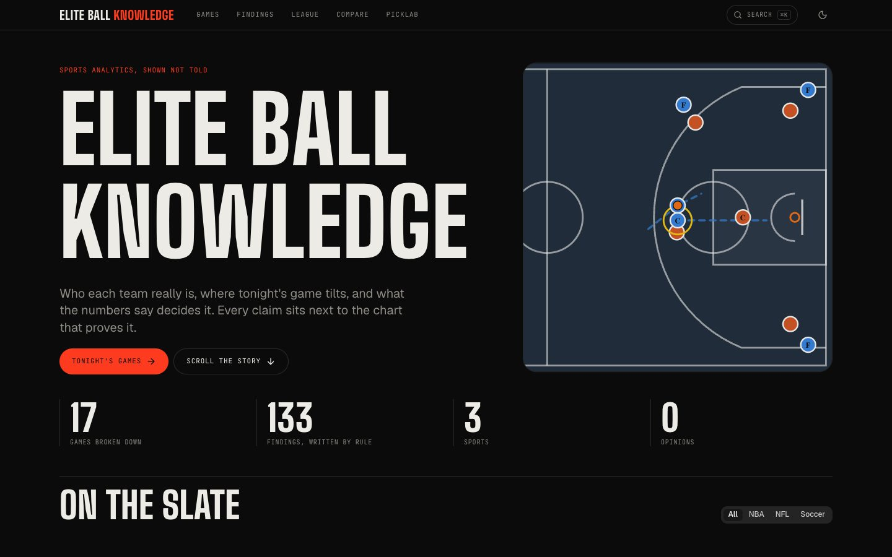
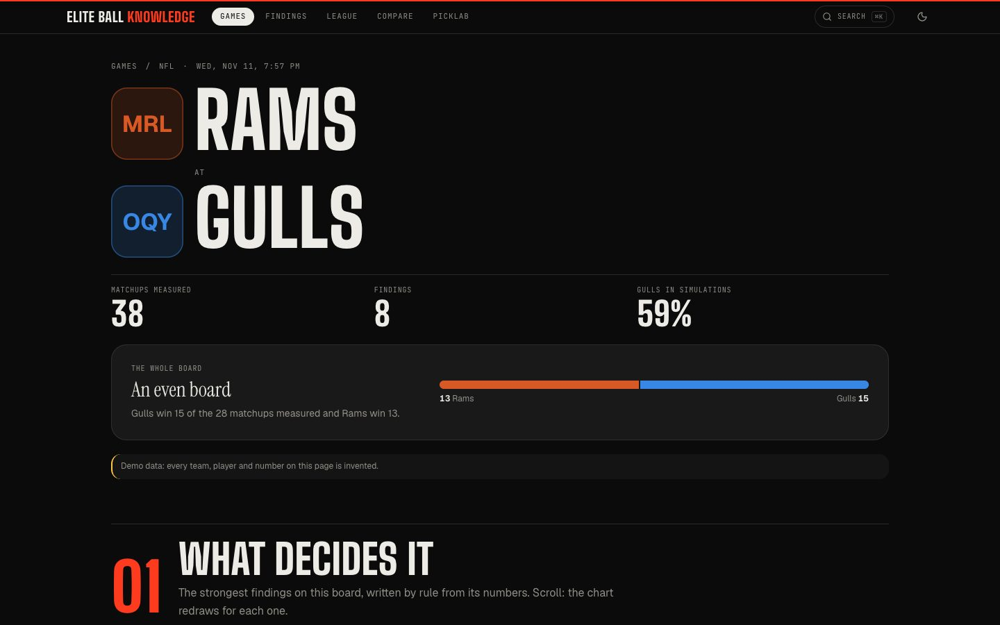
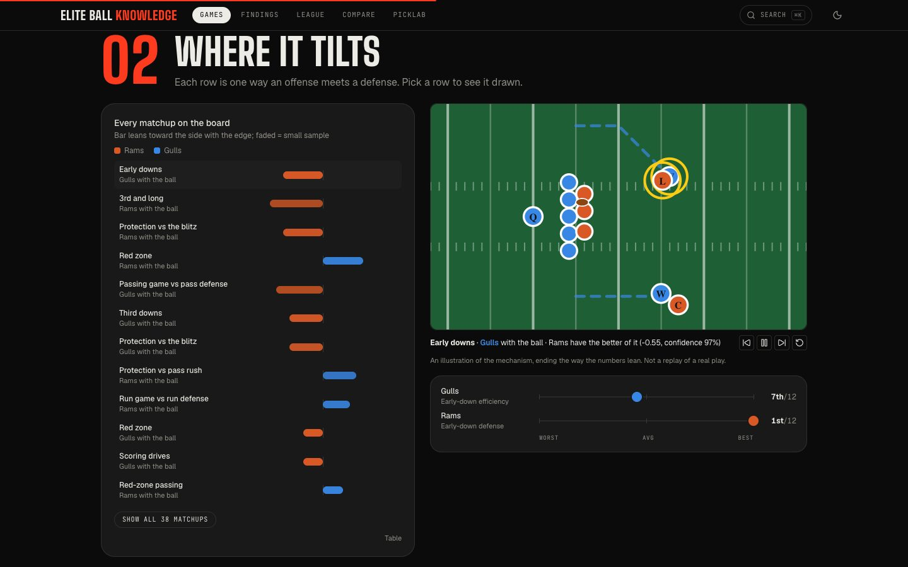
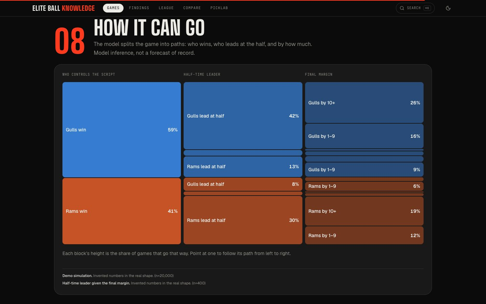

# Elite Ball Knowledge

Sports analytics you can check. Every team's identity, every matchup's edge, and what the numbers say decides the
game, each claim next to the chart that shows it.



| A game, told as a scroll | Where it tilts | How it can go |
| --- | --- | --- |
|  |  |  |

*Screenshots are of the invented demo data the repository ships with.*

- **Games**: one page per game, told as a scroll: the read on the whole board, the strongest findings one at a time,
  every offense-against-defense matchup with an animated diagram, both identities on one scale, the players it runs
  through, (NFL) the game simulated twenty thousand times, how the game can go as a tree of paths, and what happened
  the last times the two met.
- **Findings**: everything the numbers noticed across the slate, strongest first, filtered by kind and sport.
- **Compare**: any two teams as if they met today, with the same edges and findings a scheduled game gets.
- **League**: every team on one plot (offense across, defense up), a power table, player leaders, and any single
  trait ranked across the league.
- **Search**: `⌘K` or `/` jumps to any team, player or game.
- **Teams and players**: identity strips, form against opponent strength, production ranked by position.
- **How it works**: the method, with the two formulas you can play with.
- **PickLab**: public analysts' picks written down as facts and graded against the final score, so a record is
  something you can look up. Paper strategies are tracked the same way.

**[Read the case study](docs/CASE_STUDY.md)**: the problem, the architecture, the decisions and what testing found.

No finding is written by a person or a language model. Each is a fixed rule over computed numbers
(`api/insights/engine.py`), so the same numbers always give the same sentence, and every rank in a sentence is a
rank on the page.

## How it is built

```
web/  Next.js (App Router), TypeScript, Tailwind, Astryx (components), Framer Motion, Recharts
      app/(ebk)/        the pages
      components/ebk/   charts: percentile duels, rank shifts, edge ladder, identity rails, league plot
      components/ebk/Shell.tsx  search palette, themed controls, shared-element page transitions
      components/motion scroll progress, parallax, pinned scroll scenes, draw-in on view
      components/tactics animated field, pitch and court diagrams in real units

api/  FastAPI, Python 3.12
      ebk/app.py        the server: read-only, rate-limited, security headers, generic errors
      ebk/store.py      one SQLite file, opened read-only: finished boards and stored documents
      ebk/analytics.py  slate, game, league, team and player routes
      ebk/picklab.py    picks, records, strategies, sources
      insights/         the rule engine that writes the findings
      tactics/          the vocabulary: traits and the mechanisms that pit one against another
      ebk/demo.py       builds a database of invented data so everything runs from a clean checkout
```

The server that faces the internet does very little on purpose. It has no write route, no credentials, no outbound
request and no model call. It answers GET, HEAD and OPTIONS only, limits each client address, sends security
headers on every response (including errors), accepts only the hosts and origins it is told to, and never returns
a traceback. The web app sends a Content-Security-Policy that allows scripts, styles, fonts and requests from its
own origin only; it loads no third-party script, sets no cookie and uses no tracker.

Team marks and player photos are decoration beside a name, hotlinked from two image hosts and replaced by a drawn
monogram when there is none (the demo's invented teams have none). `NEXT_PUBLIC_TEAM_MEDIA=0` turns the layer off,
and the policy then allows no third-party image at all. The marks belong to their owners.

## Run it

```bash
make install   # Python venv + npm packages
make demo      # api/site.db, invented data
make dev       # API on :8030, site on http://localhost:3000
make test      # API tests, type check, lint
```

Browser checks (page transitions, reduce-motion, phone widths, search, security headers) run against the two servers:

```bash
cd web && npm i -D playwright && npx playwright install chromium
BROWSER_TEST_BASE=http://localhost:3000 npm run test:site
```

## Deploy

Two small pieces, both fine on a free tier:

1. **API**: any host that runs a Python process. `uvicorn ebk.app:app --host 0.0.0.0 --port $PORT` from `api/`, with
   `site.db` beside it. Set `PUBLIC_HOSTS` to the API's hostname, `PUBLIC_ORIGIN` to the site's origin, and
   `TRUST_PROXY=true` only if the host puts its own proxy in front (it then reads the client address from
   `X-Forwarded-For`, which is what the rate limit keys on).
2. **Web**: any host that runs Next.js. Set `API_BASE` to the API's URL, `NEXT_PUBLIC_SITE_URL` to the site's
   address and, when it should be found by search engines, `NEXT_PUBLIC_INDEXABLE=1`. Until that last one is set the
   site sends `noindex` and a robots.txt that disallows everything, so a preview is never indexed by accident.

Refreshing the data is replacing `site.db` and restarting the API; the server never writes to it.

## The data

`make demo` invents everything: teams, players, analysts, outlets and every number (seeded, so a rebuild is
identical). The shapes are the real ones. A real build fills the same two tables from public box scores and
play-by-play computed before each game, and from picks read as facts with a link to the article they came from.

## The method in three lines

1. Put every trait on one league scale: a percentile where 100 is best *for the team that owns it*.
2. Take the schedule out: remove the average strength of the opponents faced, then rank again.
3. Compare what one side does with what the other allows: `edge = attack percentile + (1 − defense percentile) − 1`.

Analysis, not advice.

## Licence

Source-available under the [PolyForm Noncommercial License 1.0.0](LICENSE): read it, run it, learn from it and build on
it for any noncommercial purpose. Commercial use needs the author's permission. Third-party packages keep their own
licences; team names and marks belong to their owners.
